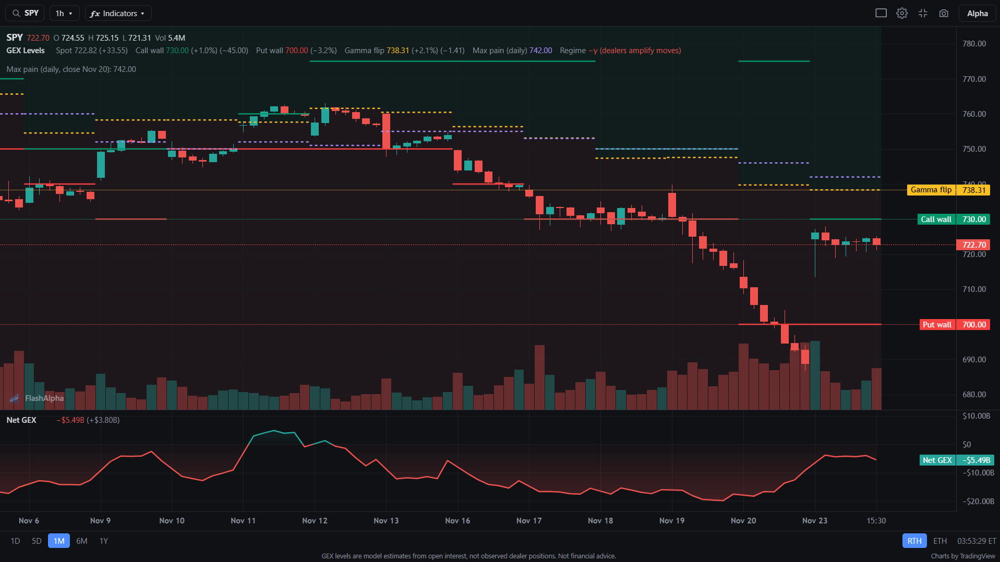
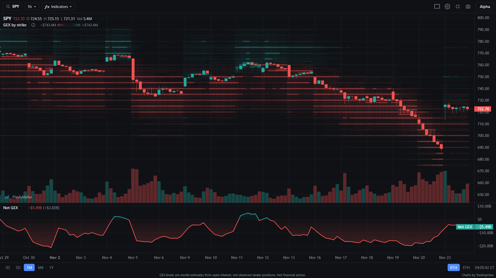
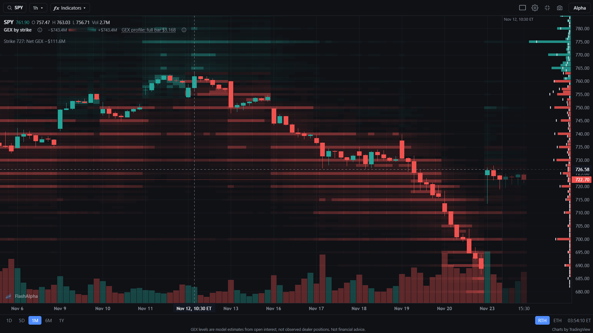
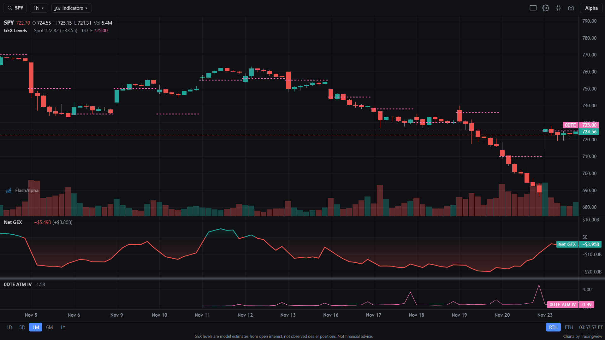

<p align="center">
  <a href="https://flashalpha.com/?utm_source=github&utm_medium=readme&utm_campaign=tradingview-gex-flashalpha">
    
  </a>
</p>

<h1 align="center">TradingView GEX by FlashAlpha</h1>

<p align="center">
  <strong>Options gamma exposure (GEX) indicators drawn on a live candlestick chart: call wall, put wall, gamma flip, max pain, 0DTE magnet, net GEX, strike heatmap and GEX profile.</strong><br>
  Data from the <a href="https://flashalpha.com/?utm_source=github&utm_medium=readme&utm_campaign=tradingview-gex-flashalpha">FlashAlpha</a> options analytics API. Built on TradingView Lightweight Charts™.
</p>

<p align="center">
  <a href="https://www.npmjs.com/package/tradingview-gex-flashalpha"></a>
  <a href="LICENSE"></a>
  <a href="https://github.com/tradingview/lightweight-charts"></a>
  
  
</p>

<p align="center">
  
</p>

<p align="center">
  <strong><a href="https://flashalpha-lab.github.io/tradingview-gex-flashalpha/">Live demo</a></strong> ·
  <a href="#indicators-at-a-glance">Indicators</a> ·
  <a href="#add-the-chart-to-your-site-in-one-line">Embed in one line</a> ·
  <a href="#install-from-npm">npm install</a> ·
  <a href="https://flashalpha.com/pricing?utm_source=github&utm_medium=readme&utm_campaign=tradingview-gex-flashalpha">Free API key</a> ·
  <a href="#faq">FAQ</a>
</p>

**TradingView GEX by FlashAlpha** puts options dealer positioning on the price chart. Its indicators turn FlashAlpha's
gamma exposure (GEX) data into lines, shading and panes on a TradingView-style candlestick chart, bar by bar and on the
same time axis as the candles. You see where the call wall and put wall sit, which side of the gamma flip the price is
on, and which strikes hold the most dealer gamma, without leaving the chart.

The chart is open source and built on
[TradingView Lightweight Charts™](https://github.com/tradingview/lightweight-charts). The indicators read the FlashAlpha
chart API with your FlashAlpha API key.

**In short**

- **What it shows:** call wall, put wall, gamma flip, max pain, 0DTE magnet, gamma regime, net GEX, net GEX per strike
  (heatmap and profile), delta / vanna / charm exposure, and 0DTE metrics such as the pin score.
- **Where:** US stocks, ETFs and indices such as SPX, SPY, QQQ, AAPL, MSFT and TSLA, from 1-minute to weekly bars.
- **How:** one `<div>` and one `<script>` tag on any website, or `npm install tradingview-gex-flashalpha` and
  `mount(el, { symbol: 'SPX' })` in your app.
- **Cost:** the chart is free and open source. Data needs a FlashAlpha API key; the free plan shows the candles, and GEX
  indicators start on the Basic plan.

---

## Table of contents

- [Why GEX on the price chart?](#why-gex-on-the-price-chart)
- [Indicators at a glance](#indicators-at-a-glance)
- [1. GEX Levels: call wall, put wall, gamma flip, max pain, 0DTE magnet](#1-gex-levels-call-wall-put-wall-gamma-flip-max-pain-0dte-magnet)
- [2. Net GEX pane](#2-net-gex-pane)
- [3. GEX by strike: strike heatmap and GEX profile](#3-gex-by-strike-strike-heatmap-and-gex-profile)
- [4. Greeks exposure and 0DTE metrics pane](#4-greeks-exposure-and-0dte-metrics-pane)
- [5. 0DTE scope and live open interest](#5-0dte-scope-and-live-open-interest)
- [Chart features](#chart-features)
- [Which plan unlocks which indicator?](#which-plan-unlocks-which-indicator)
- [Add the chart to your site in one line](#add-the-chart-to-your-site-in-one-line)
- [Install from npm](#install-from-npm)
- [How do I add my FlashAlpha API key?](#how-do-i-add-my-flashalpha-api-key)
- [Use without a bundler](#use-without-a-bundler)
- [Framework examples](#framework-examples)
- [Options](#options)
- [Methods](#methods)
- [Several charts (layouts)](#several-charts-layouts)
- [Events](#events)
- [Core layers and FlashAlpha layers](#core-layers-and-flashalpha-layers)
- [Keep your API key safe](#keep-your-api-key-safe)
- [Use your own data](#use-your-own-data)
- [Add layers](#add-layers)
- [Who uses GEX indicators?](#who-uses-gex-indicators)
- [FAQ](#faq)
- [About FlashAlpha](#about-flashalpha)
- [Development](#development)
- [License, trademarks and disclaimer](#license-trademarks-and-disclaimer)

---

## Why GEX on the price chart?

**Gamma exposure (GEX)** estimates how much options market makers (dealers) must buy or sell the underlying to stay
delta-hedged as the price moves. It is computed from open interest and each option's gamma, strike by strike.

- When dealers are **long gamma** (positive GEX), they sell rallies and buy dips. Moves tend to be **dampened** and the
  price often pins near large strikes.
- When dealers are **short gamma** (negative GEX), they buy rallies and sell dips. Moves tend to be **amplified** and
  ranges widen.

Most GEX tools show a bar chart by strike for one moment. TradingView GEX by FlashAlpha draws the same information **over
time, on the candles**, so you can see how the levels moved during the session, where the price reacted to them, and
whether the regime changed. That makes the context usable for intraday trading, 0DTE options and risk planning.

The levels are model estimates from open interest, not observed dealer positions. The theory and the math are in
[gex-explained](https://github.com/FlashAlpha-lab/gex-explained).

---

## Indicators at a glance

| Indicator | What it draws | Main benefit | Lowest plan |
|---|---|---|---|
| [GEX Levels](docs/indicators/gex-levels.md) | Call wall, put wall, gamma flip and max pain lines, the 0DTE magnet, the gamma regime tint and the previous session's levels | Key support, resistance and regime levels from options positioning, right on the price | Basic |
| [Net GEX](docs/indicators/net-gex.md) | Net dealer gamma in dollars as a line around zero in a pane under the price | See at a glance when dealers switch from dampening to amplifying moves | Basic |
| [GEX by strike](docs/indicators/gex-by-strike.md) | Strike heatmap behind the candles and a GEX profile at the right edge, with GEX, delta, vanna and charm lenses | Find the strikes that attract, stall or accelerate the price | Growth |
| [Greeks and 0DTE metrics](docs/indicators/metrics-pane.md) | A pane for delta, vanna or charm exposure, or a 0DTE metric such as pin score, IV ratio, VIX or dealer hedge per ±1 % | Track the forces behind the levels, minute by minute | Basic (Greeks), Growth (metrics) |
| [0DTE scope and live OI](docs/indicators/0dte-and-live-oi.md) | The same indicators computed on today's expiry only, or on open interest updated with today's flow | Same-day options context for 0DTE traders | Growth (0DTE), Alpha (live OI) |

GEX Levels, Net GEX and GEX by strike are in the chart's **Indicators** menu, whatever your plan; the metrics pane is a
setting of Net GEX, the 0DTE scope and live open interest are settings of GEX Levels. A layer above your plan shows a
lock and the plan it needs.

---

## 1. GEX Levels: call wall, put wall, gamma flip, max pain, 0DTE magnet

The core indicator. It draws the levels options traders watch most, bar by bar through the session.

| Level | What it is | How traders use it |
|---|---|---|
| **Call wall** (green, solid) | The strike at or above spot with the largest call positioning | Often acts as resistance: dealer hedging tends to slow rallies into it |
| **Put wall** (red, solid) | The strike at or below spot with the largest put positioning | Often acts as support: dealer hedging tends to slow sell-offs into it |
| **Gamma flip** (amber, dashed) | The price where net dealer gamma changes sign | The line between the calm regime (above) and the volatile regime (below) |
| **Max pain** (violet, dashed) | The strike where open options lose the most value at expiry | A pull toward expiry, most visible on expiration days |
| **0DTE magnet** (pink, dashed) | The same-day strike the price is most drawn to | An intraday target on days with heavy 0DTE positioning |

**Benefits**

- **Levels on the candles, not in a separate table.** Each level is drawn per bar, so you see exactly when a wall moved
  and how the price behaved at it.
- **Gamma regime at a glance.** The background is tinted green above the gamma flip (positive gamma, moves tend to
  dampen) and red below it (negative gamma, moves tend to amplify).
- **Distance from spot in the legend.** For example `Call wall 730.00 (+1.0%) (−45.00)`: the level, its distance from
  spot and its change since the previous session. The legend also names the regime, for example
  `Regime −γ (dealers amplify moves)`.
- **Never lose an off-screen level.** A level outside the visible range is pinned to the chart edge with its distance,
  for example `▲ Call wall 8,000.00 (+11.5%)`.
- **Broken-wall alerts (optional).** When a candle closes through a wall, the wall fades for the rest of the session and
  a marker such as `Put wall broken 10:30` appears on the bar.
- **Previous-session levels.** On daily and weekly bars, each session shows the prior close's levels as dashed lines.
- **Session focus.** Hover a session and the other sessions fade, so one day's levels and candles stand out.
- **Your colours.** Colour, width, line style, price line and axis label per level, like TradingView's Style tab.

Read more: [GEX Levels](docs/indicators/gex-levels.md).

---

## 2. Net GEX pane

<p align="center">
  
</p>

Net dealer gamma exposure in dollars, drawn as a line around zero in its own pane under the price: green above zero,
red below.

**Benefits**

- **Regime changes are obvious.** A cross below zero tells you dealers have turned short gamma and moves may speed up.
- **Size, not only sign.** A net GEX of +$5B and one of +$200M mean very different market behaviour; the pane shows both.
- **Change since the previous session** in the legend, for example `Net GEX −$5.49B (+$3.80B)`.
- **Sessions kept apart.** The line is cut between sessions, and hovering a session fades the others.

Read more: [Net GEX](docs/indicators/net-gex.md).

---

## 3. GEX by strike: strike heatmap and GEX profile

<p align="center">
  
</p>

The full options positioning by strike, on the price axis.

- **Strike heatmap:** net GEX per strike behind the candles, for every bar. Green strikes are long gamma, red strikes
  short gamma; stronger colour means more gamma. The 8 largest strikes stand out and far-away strikes fade, so the chart
  stays readable. Hover a strike to read its value, for example `Strike 727: Net GEX −$111.6M`.
- **GEX profile:** net GEX per strike as horizontal bars at the right edge of the chart, for the latest snapshot or the
  bar under your cursor. Small ticks show where each strike stood 15 minutes earlier; the legend gives the value of a
  full bar, for example `GEX profile: full bar $3.16B`.
- **Lenses:** switch both from **gamma (GEX)** to **delta (DEX)**, **vanna (VEX)** or **charm (CHEX)** exposure per strike.

**Benefits**

- **See where liquidity sits.** Large long-gamma strikes tend to slow the price; large short-gamma strikes can let it run.
- **Watch positioning change during the day.** The heatmap shows a strike building or fading over time, not only now.
- **Compare with 15 minutes ago.** The profile's ticks reveal which strikes are gaining or losing gamma right now.
- **One chart, four Greeks.** Vanna shows sensitivity to implied volatility, charm the drift into the close, delta the
  directional hedge.

Read more: [GEX by strike](docs/indicators/gex-by-strike.md).

---

## 4. Greeks exposure and 0DTE metrics pane

<p align="center">
  
</p>

A pane under the price for one exposure or metric, minute by minute. Pick it in the **Metric pane** setting of the Net GEX
indicator.

| Metric | What it tells you | Plan |
|---|---|---|
| Delta (net DEX) | The directional hedge dealers hold | Basic |
| Vanna (net VEX) | How dealer hedging changes when implied volatility moves | Basic |
| Charm (net CHEX) | How dealer hedging drifts with time, strongest into the close and expiry | Basic |
| 0DTE pin score | How likely the price is to pin near a strike today | Growth |
| 0DTE move left (±$) | The 1σ move the market still prices for today | Growth |
| 0DTE ATM IV, IV ratio 0DTE / 7DTE, 25Δ skew, VIX | Volatility context for same-day options | Growth |
| 0DTE net GEX, 0DTE share of GEX, 0DTE put/call volume, 0DTE net theta | How much of the day is driven by same-day options | Growth |
| Distance to flip (σ) | How far the price is from the gamma flip, in standard deviations | Growth |
| Dealer hedge if +1 % / −1 % ($) | The notional dealers would buy or sell on a 1 % move | Growth |

**Benefits:** the forces behind the levels, on the same time axis as the price. Spot a rising pin score into the
afternoon, a vanna build before an event, or a hedge estimate that grows as the price nears the flip.

Read more: [Greeks and 0DTE metrics](docs/indicators/metrics-pane.md).

---

## 5. 0DTE scope and live open interest

Two settings in the options of GEX Levels change what every indicator is computed on:

- **Expiries: All or 0DTE.** With 0DTE, the walls, flip, magnet, heatmap and profile use today's expiry only. (Growth)
- **Open interest: Settled or Live.** Live adds today's option flow to the last settled open interest, so the levels
  follow positioning during the session instead of waiting for tomorrow's update. (Alpha)

**Benefits:** same-day options now drive a large share of index volume. The 0DTE scope shows the levels that matter
**today**, and live open interest keeps them current as new positions open.

Read more: [0DTE scope and live OI](docs/indicators/0dte-and-live-oi.md).

---

## Chart features

The indicators run on a full TradingView-style chart:

- **Candles and volume** from 1-minute to weekly bars, regular or extended hours, on a US Eastern time axis.
- **TradingView-style legend:** each indicator's line starts with its title, with hide, options and remove buttons.
- **Indicators menu** with options per layer: colours, line widths, line styles, price lines and axis labels.
- **Layouts:** one to four charts side by side, each with its own interval and indicators (19 layouts).
- **Auto-refresh** every 60 seconds, and optional live streaming of candles and levels over WebSocket (the `live`
  option).
- **More history as you drag** to the left edge of the chart.
- **Symbol search, date ranges, full screen, screenshot, light and dark themes, phone layout.**
- **Framework-free:** plain JavaScript for React, Vue, Angular, Svelte or a single HTML page. Its CSS never restyles your
  page (every rule sits under its own `fac-` classes).
- **npm package:** ES module, CommonJS and script-tag builds, a separate style sheet, and TypeScript declarations.

---

## Which plan unlocks which indicator?

| FlashAlpha plan | What the chart shows |
|---|---|
| **Free** | Candles and volume |
| **Basic** | GEX Levels (call wall, put wall, gamma flip, max pain, 0DTE magnet), Net GEX pane, delta / vanna / charm exposure panes |
| **Growth** | Basic, plus the strike heatmap, the GEX profile with GEX / DEX / VEX / CHEX lenses, the 0DTE scope, and 0DTE and volatility metrics |
| **Alpha** | Growth, plus the live open interest basis |

The chart reads the plan from your API key; you do not set it. The API enforces the plan; the chart only shows it. Prices
and daily request limits are on the
[FlashAlpha pricing page](https://flashalpha.com/pricing?utm_source=github&utm_medium=readme&utm_campaign=tradingview-gex-flashalpha).

---

## Add the chart to your site in one line

1. [Create a free FlashAlpha account](https://flashalpha.com/pricing?utm_source=github&utm_medium=readme&utm_campaign=get_api_key)
   and copy your API key from your [profile](https://flashalpha.com/profile?utm_source=github&utm_medium=readme&utm_campaign=get_api_key).
2. Add a `div` and the embed script:

```html
<div data-flashalpha-chart
     data-symbol="SPY"
     data-resolution="5m"
     data-layers="levels,maxpain,netgex"
     style="height: 520px"></div>

<script async src="https://charts.flashalpha.com/embed.js" data-key="YOUR_FLASHALPHA_API_KEY"></script>
```

The script loads Lightweight Charts, the chart and the FlashAlpha indicators from the chart host, then draws every
element that has `data-flashalpha-chart`. A full page is in [`examples/embed.html`](examples/embed.html). If your page
adds charts after it loads, for example in a single-page app, call `FlashAlphaEmbed.scan()`.

| Layer ID for `data-layers` | Indicator |
|---|---|
| `levels` | GEX Levels: call wall, put wall, gamma flip |
| `maxpain` | GEX Levels: max pain |
| `magnet` | GEX Levels: 0DTE magnet |
| `netgex` | Net GEX pane |
| `heatmap` | GEX by strike: strike heatmap |
| `profile` | GEX by strike: GEX profile |

| Attribute | Default | Description |
|---|---|---|
| `data-symbol` | Required | Ticker, for example `SPX` or `SPY`. |
| `data-key` | The script tag's `data-key` | FlashAlpha API key for this chart. |
| `data-resolution` | `5m` | One of `1m`, `5m`, `15m`, `1h`, `1d`, `1w`. |
| `data-range` | Depends on resolution | Days to show, or `1D`, `5D`, `1M`, `6M`, `1Y`. |
| `data-theme` | `dark` | `dark`, `light`, or `auto`. |
| `data-upgrade-url` | FlashAlpha pricing | Where locked layers and the Upgrade button link. |
| `data-layers` | None | Comma-separated layer IDs from the table above. Without it the chart opens with price and volume; the reader's picks are remembered. |
| `data-session` | `rth` | `rth` for regular hours, `eth` to add pre-market and after-hours. |
| `data-controls` | `true` | `false` hides the toolbar. |
| `data-background` | `#0f1115` | Chart background color, used with the theme of its kind (see `background` under [Options](#options)). |
| `data-refresh` | `60` | Seconds between refreshes while the page is visible. `0` turns refresh off. |
| `data-base` | The script's host | Chart API root URL, for example when you use a proxy. |

On the `<script>` tag, `data-key` sets the key for every chart on the page, `data-layer-bundle="false"` skips the
FlashAlpha layers (GEX Levels only), and `data-debug="true"` shows load status. Lightweight Charts 5.3.0 is loaded from
the chart host, not a CDN. A copy the page already has is used only when it is the same version; otherwise the charts get
their own copy and the page keeps its `window.LightweightCharts`.

On a public website, use an **embed key** (`fa_pk_…`) instead of your secret API key: it is read-only, reads chart data
only, works only on the domains you list, and expires. See [Keep your API key safe](#keep-your-api-key-safe).

---

## Install from npm

```sh
npm install tradingview-gex-flashalpha lightweight-charts@5.3.0
```

Lightweight Charts 5 is a peer dependency; the chart never bundles it. Each release is tested with one version, **5.3.0**
for this one.

```html
<div id="chart" style="height: 480px"></div>
```

```js
import * as LightweightCharts from 'lightweight-charts';
import { mount } from 'tradingview-gex-flashalpha';

const chart = mount(document.getElementById('chart'), {
  lightweightCharts: LightweightCharts,
  baseUrl: 'https://charts.flashalpha.com',
  apiKey: 'YOUR_FLASHALPHA_API_KEY',
  symbol: 'SPX',
  resolution: '5m',
  layers: ['levels', 'maxpain'],
});
```

Replace `YOUR_FLASHALPHA_API_KEY` with your key. The chart fills its container and follows its size, so give the
container a height. It adds its style sheet to the page the first time it mounts. For a strict Content Security Policy,
load the style sheet yourself and pass `injectCss: false`:

```js
import 'tradingview-gex-flashalpha/style.css';
mount(el, { lightweightCharts: LightweightCharts, injectCss: false, /* ... */ });
```

**What the npm package draws.** The package is the chart and the core layers of GEX Levels: call wall, put wall, gamma
flip and max pain (`levels`, `maxpain`), with the daily levels, the regime tint and the broken-wall markers. The other
indicators (0DTE magnet, Net GEX, GEX by strike, the metrics pane, the 0DTE scope and live open interest) are FlashAlpha
layers served by the chart host: use the [embed](#add-the-chart-to-your-site-in-one-line), or the
[script build](#use-without-a-bundler) with the layer file. See
[Core layers and FlashAlpha layers](#core-layers-and-flashalpha-layers).

---

## How do I add my FlashAlpha API key?

The chart reads the FlashAlpha **chart API** (`https://charts.flashalpha.com`: `/v1/symbols`, `/v1/bars`, `/v1/charts`),
not the other FlashAlpha APIs. It sends the key in the `X-Api-Key` header. Use the same placeholder,
`YOUR_FLASHALPHA_API_KEY`, in whichever setup you use.

**JavaScript option**

```js
mount(el, { baseUrl: 'https://charts.flashalpha.com', apiKey: 'YOUR_FLASHALPHA_API_KEY', symbol: 'SPX', lightweightCharts: LightweightCharts });
```

**Once per page, for every chart mounted afterward**

```js
FlashAlphaChart.setLicenseKey('YOUR_FLASHALPHA_API_KEY');
FlashAlphaChart.mount(el, { symbol: 'SPX', baseUrl: 'https://charts.flashalpha.com' });
```

**HTML attribute (embed)**

```html
<script async src="https://charts.flashalpha.com/embed.js" data-key="YOUR_FLASHALPHA_API_KEY"></script>
```

**Environment variable (Vite)**

```bash
VITE_FLASHALPHA_API_KEY=YOUR_FLASHALPHA_API_KEY
```

```js
mount(el, { apiKey: import.meta.env.VITE_FLASHALPHA_API_KEY, baseUrl: 'https://charts.flashalpha.com', symbol: 'SPX', lightweightCharts: LightweightCharts });
```

**Environment variable (Next.js):** `NEXT_PUBLIC_FLASHALPHA_API_KEY=YOUR_FLASHALPHA_API_KEY`.

**Your own server (for public websites)**

```js
mount(el, { baseUrl: '/api/flashalpha-charts', symbol: 'SPX', lightweightCharts: LightweightCharts });
```

Your server forwards the requests to `https://charts.flashalpha.com` and adds the key. See
[Keep your API key safe](#keep-your-api-key-safe).

You do not need to set your plan: the chart API answers with the key's plan, and the chart turns layers on or locks them
to match it.

---

## Use without a bundler

Serve the files from your own site and load the script build after Lightweight Charts. It sets
`window.FlashAlphaChart`. To get the FlashAlpha indicators too, load the layer file from the chart host after the chart
and before `mount` (it needs `window.FlashAlphaChart`, so it does not work with the npm `import`):

```html
<div id="chart" style="height: 480px"></div>

<script src="/js/lightweight-charts-5.3.0.standalone.production.js"></script>
<script src="/js/tradingview-gex-flashalpha.min.js"></script>
<script src="https://charts.flashalpha.com/flashalpha-chart-layers.js"></script>
<script>
  FlashAlphaChart.setLicenseKey('YOUR_FLASHALPHA_API_KEY');
  FlashAlphaChart.mount(document.getElementById('chart'), {
    symbol: 'SPX',
    resolution: '5m',
    baseUrl: 'https://charts.flashalpha.com',
    layers: ['levels', 'maxpain', 'netgex'],
  });
</script>
```

The built files are in `node_modules/tradingview-gex-flashalpha/dist/`, or in `dist/` after `npm run build` in this
repository:

| File | Format | Use |
|---|---|---|
| `dist/tradingview-gex-flashalpha.mjs` | ES module | `import` (bundlers, `<script type="module">`) |
| `dist/tradingview-gex-flashalpha.cjs` | CommonJS | `require` |
| `dist/tradingview-gex-flashalpha.js`, `.min.js` | Script tag | `window.FlashAlphaChart` |
| `dist/tradingview-gex-flashalpha.css` | Style sheet | `tradingview-gex-flashalpha/style.css` with `injectCss: false` |
| `dist/vendor/lightweight-charts-5.3.0.*` | Script, LICENSE, NOTICE | The tested Lightweight Charts, to host yourself (after `npm run build` in this repository; not in the npm package) |
| `types/index.d.ts` | TypeScript | Options, data shapes and the plugin API |

---

## Framework examples

### React

```jsx
import { useEffect, useRef } from 'react';
import * as LightweightCharts from 'lightweight-charts';
import { mount } from 'tradingview-gex-flashalpha';

export function GexChart({ symbol = 'SPX' }) {
  const ref = useRef(null);

  useEffect(() => {
    const chart = mount(ref.current, {
      lightweightCharts: LightweightCharts,
      baseUrl: 'https://charts.flashalpha.com',
      apiKey: import.meta.env.VITE_FLASHALPHA_API_KEY,
      symbol,
      layers: ['levels', 'maxpain'],
    });
    return () => chart.destroy();
  }, [symbol]);

  return <div ref={ref} style={{ height: 480 }} />;
}
```

### Vue 3

```vue
<script setup>
import { onMounted, onBeforeUnmount, ref } from 'vue';
import * as LightweightCharts from 'lightweight-charts';
import { mount } from 'tradingview-gex-flashalpha';

const el = ref(null);
let chart;

onMounted(() => {
  chart = mount(el.value, {
    lightweightCharts: LightweightCharts,
    baseUrl: 'https://charts.flashalpha.com',
    apiKey: import.meta.env.VITE_FLASHALPHA_API_KEY,
    symbol: 'SPY',
    layers: ['levels', 'maxpain'],
  });
});
onBeforeUnmount(() => chart?.destroy());
</script>

<template><div ref="el" style="height: 480px" /></template>
```

### Angular, Svelte and others

Call `mount(element, options)` after the element is in the DOM, and `chart.destroy()` when the component is destroyed.

More examples are in [`examples/`](examples): a basic page, the one-line embed, and your own data source.

---

## Options

`mount(element, options)` (or `FlashAlphaChart.mount` with the script build) accepts these options:

| Option | Default | Description |
|---|---|---|
| `symbol` | First symbol with data | Ticker. |
| `resolution` | `5m` | One of `1m`, `5m`, `15m`, `1h`, `1d`, `1w`. |
| `days` | Depends on resolution | Number of days to show. Each resolution has a maximum. |
| `session` | `rth` | `rth` or `eth`. |
| `layers` | None | Layer IDs: `levels`, `maxpain`, and IDs from registered layer plugins (the FlashAlpha layers). By default the chart opens with price and volume only. |
| `storage` | `true` | Remembers the layers the reader turns on or off (localStorage) and opens with them next time, over `layers`. `false` turns it off. |
| `storageKey` | `tradingview-gex-flashalpha:layers` | The localStorage key, to keep the picks of different charts apart. |
| `controls` | `true` | `false` hides the toolbar (and the Layout menu: one chart). |
| `layouts` | `true` | The **Layout** menu next to Settings: one to four charts. `false` mounts one chart. See [Several charts](#several-charts-layouts). |
| `layout` | `1` | The layout the chart opens with (`1`, `2v`, `2h`, `3v` ... `4tr`); the reader's last pick wins. |
| `symbolButtons` | `true` | `false` hides the symbol dropdown. |
| `exposure` | `true` | `false` draws candles only. |
| `source` | FlashAlpha chart API | Your own data source. See [Use your own data](#use-your-own-data). |
| `apiKey` | `setLicenseKey` value | FlashAlpha API key, sent as `X-Api-Key`. |
| `baseUrl` | Same origin | Chart API root URL: `https://charts.flashalpha.com`, or your proxy. |
| `refresh` | `60` | Seconds between refreshes. `0` turns refresh off. |
| `live` | `false` | `true` draws 1m to 1h candles and levels live from the chart API's WebSocket (`/v1/live`, FlashAlpha chart API only). While it is connected the refresh runs every 5 minutes; while it is down the chart refreshes as usual. |
| `theme` | `dark` | `dark`, `light`, or `auto` (follows the reader's system setting). |
| `background` | Per theme | Background color. A dark color is used with the dark theme and a light color with the light theme; the other theme keeps its own background, so the text stays readable when the reader switches theme. A color given other than as hex or `rgb()` (a name, `hsl()`, `var()`) is used with both. You can also set the CSS variable `--fac-bg`. |
| `upgradeUrl` | FlashAlpha pricing | Where locked layers, the Upgrade box and the plan name in the toolbar link. |
| `upsell` | `false` | `true` shows an **Upgrade** box over the chart while a layer that is on needs a higher plan (hidden by default for now). |
| `account` | `true` | `false` hides the account button at the right of the toolbar: **Sign up** when the chart has no plan (no key), the plan's name (for example **Growth**) when the API returns one. |
| `signupUrl` | FlashAlpha pricing | Where the **Sign up** button and the **Sign up free** box link. |
| `debug` | `false` | Shows load status in the toolbar. `'latency'` also shows the live lag (p50/p95). |
| `note` | Model-estimate disclaimer | A line under the chart next to the credit. `''` hides it. |
| `brand` | None | `{ logo, href, name }`: shows your logo, linked to `href`, at the bottom left of the price pane instead of the TradingView logo, and a "Charts by TradingView" link under the chart. |
| `lightweightCharts` | `window.LightweightCharts` | The Lightweight Charts module, if you import it instead of loading the script. |
| `styles` | Plugin defaults | Plot styles by plot ID, for example `{ callWall: { color: '#00c853', lineWidth: 2 } }` (`color`, `lineWidth`, `lineStyle`, `visible`, `priceLine`, `axisLabel`). Plot IDs of the core indicator: `callWall`, `putWall`, `flip`, `flipUnverified`, `maxPain`. |
| `injectCss` | `true` | `false` doesn't add the chart's `<style>` to the page. Load `tradingview-gex-flashalpha/style.css` yourself. |

## Methods

```js
chart.setSymbol('SPY');
chart.setResolution('15m');
chart.setLayers(['levels', 'maxpain']);
chart.setTheme('light');
chart.destroy();
```

| Member | Description |
|---|---|
| `setSymbol(symbol)` | Load another ticker. |
| `setResolution(resolution)` | `1m` to `1w`. |
| `setRange(days)` | Days back from now, capped per resolution. |
| `setSession('rth' \| 'eth')` | Regular hours, or with pre-market and after-hours. |
| `setLayers([...])` | The layers to draw. |
| `setTheme(theme)` | `dark`, `light` or `auto`. |
| `setStyle(plotId, style)` / `styles` | Change a plot's colour, width, line style or visibility, as a layer's options do. |
| `layers`, `plan` | The layers drawn, and the key's plan from the last answer (`null` before it). |
| `reload()` | Load the window again. |
| `destroy()` | Remove the chart. A chart whose element leaves the page stops refreshing by itself. |
| `chart` | The Lightweight Charts instance, for your own series. |

With the FlashAlpha layers loaded, the chart also has `setExposure({ scope, basis })` (for example
`chart.setExposure({ scope: 'zero_dte', basis: 'live' })`), `setMetric(name)` and `setLens(lens)`.

Static functions: `mount`, `registerLayers`, `setLicenseKey`, `chartEngineSource(baseUrl, apiKey)`, `plans`, `version`
(and `FlashAlphaChart.layers` with the script build).

## Several charts (layouts)

The **Layout** button next to Settings splits the chart into one to four charts, like TradingView's layouts: 1;
2 side by side or one above the other; 3 in columns, rows, or one large chart with two small ones; 4 in a grid, rows,
columns, or one large chart with three small ones. Use it to watch several intervals (1m, 5m, 15m, 1h) or different
indicators on the same symbol.

- One toolbar and one time bar act on the chart in focus (outlined); click a chart to focus it. Each chart keeps its own
  interval, range, session, indicators and Settings.
- A new symbol goes to every chart. The theme too.
- A new chart opens with an interval no other chart has (1m, 5m, 15m, 1h ...) and no indicator.
- The layout and each chart's interval, range and session are remembered (localStorage, `storageKey` + `:group`);
  the layers of the first chart under `storageKey`, of the others under `storageKey:2` to `storageKey:4`.
- Below 640 px wide only the chart in focus shows and the Layout menu is hidden.

```js
const chart = FlashAlphaChart.mount(el, { symbol: 'SPX', layout: '2v' });
chart.setLayout('4');          // 2 x 2
chart.charts[1].setResolution('1m');
chart.focus(1);                // the toolbar now acts on the second chart
```

| Member | Description |
|---|---|
| `setLayout(id)` / `layout` | The layout: `1`, `2v`, `2h`, `3v`, `3h`, `3l`, `3r`, `3t`, `3b`, `4`, `4h`, `4v`, `4l`, `4r`, `4t`, `4b`, `4lc`, `4rc`, `4tr`. |
| `charts` | Every chart's methods (the table above), in layout order. |
| `focus(i)` / `active` | The chart in focus, from 0. |

The other methods act on the chart in focus, except `setSymbol`, `setTheme`, `reload` and `destroy`, which act on all of
them. Each chart also has `symbol`, `resolution`, `range` and `session`. `layouts: false` mounts one chart, as before.

---

## Events

When there's no data to draw, the chart shows a message and dispatches a `flashalpha:nodata` event on the container.
When the API wants a key (`api_key_required`: a signed-out reader), the message is a sign-up box over a blurred picture
of the chart, with a **Sign up free** link to `signupUrl`.
The event bubbles, and `event.detail` has `symbol` and `error`. For example, you can hide the chart's section:

```js
el.addEventListener('flashalpha:nodata', () => { el.closest('section').hidden = true; });
```

---

## Core layers and FlashAlpha layers

The chart in this repository draws two **core layers**:

| Layer ID | What it draws |
|---|---|
| `levels` | Call wall, put wall, and gamma flip as step lines through the day. The flip is lighter when the data source marks it as not certified. |
| `maxpain` | Max pain. |

Both layers also draw the **daily levels**: each session gets the previous session's closing levels as a dashed step
line, in the colours of the intraday levels. You see them on `1d` and `1w`, and on intraday resolutions before the first
intraday level in the window (max pain: before the first intraday row that has a max pain, so where the intraday rows
have none the daily max pain continues, "Max pain (daily)" in the legend). They cover all expiries on settled open
interest, so a 0DTE scope or live flow hides them.

The price scale fits the candles, not the levels: a level far from the price is off screen, and its value stays in the
legend. Drag the price axis to bring it in.

After the last stored bar, the chart draws muted "spot" candles when the data source sends spot prices for those
minutes. Bars built from quote mids (`source: 'quotes'`, no trades that day) have no volume and the legend says
"quote mid (no trades)"; they are muted on `1m`, outside regular hours (a stub quote's mid) and when every bar in the
window is one (a symbol without trades), otherwise drawn in the normal colours. An index (`asset_class: 'index'` in
`symbols()`, such as SPX) has only quote bars, so they are drawn as normal candles. A weekly bar that mixes quote days and
trade days (`source: 'mixed'`) has no volume either, since its volume counts the trade days only; the legend says
"some days quote mid (no volume)". The chart refreshes every 60 seconds while the page is visible (it loads only the
bars after the newest one) and keeps your zoom.

The range buttons pick the first window. Drag the chart (or zoom out) to its left edge and it loads the window before
the first bar, as long as the range picked (up to the most a resolution allows in one request), until the symbol's
`first_bar` from `symbols()`; drag it to the right edge when the newest bar is more than two bars old and it loads the bars
after it. Both start after the reader touches the chart and keep the bars in view where they are.

The **FlashAlpha layers** (`magnet`, `netgex`, `heatmap`, `profile`, the metrics pane, the 0DTE scope and live open
interest, described in [Indicators at a glance](#indicators-at-a-glance)) are a layer plugin served by the chart host,
`https://charts.flashalpha.com/flashalpha-chart-layers.js`. They are not in this repository or the npm package. The embed
loads them for you; with the script build, load that file after the chart and before `mount`.

The Indicators menu lists every layer whatever your plan. A layer above your plan shows a lock and the plan it needs on
the right, and links to the pricing page; the layers your plan opens carry no plan label. Without a key (or with a key
that is not valid) the chart locks every paid layer, like the free plan.

---

## Keep your API key safe

An API key placed in browser code can be read by anyone who opens the page.

- **Personal or internal pages:** pass `apiKey` directly.
- **Public websites:** use an **embed key** (`fa_pk_…`): made from your secret key on your server, read-only, chart data
  only, locked to your domains, with an expiry. See [Embed keys](docs/embed-keys.md). Or keep the key on your server and
  set `baseUrl` to a small proxy that adds the `X-Api-Key` header to the requests it forwards to the chart API.

The chart sends the key only in the `X-Api-Key` header. It never stores the key or writes it to the URL.

---

## Use your own data

Pass an object with the following methods as the `source` option. Each method can return a value or a promise. You need
a FlashAlpha key only for FlashAlpha data.

```js
const mySource = {
  // Tickers the chart can show.
  symbols: () => [{ symbol: 'SPX', last_bar: '2026-11-10T21:00:00Z' }],

  // OHLCV bars.
  bars: (symbol, resolution, fromIso, toIso, session) => ({
    bars: [{ ts: '2026-11-10T14:30:00Z', open: 0, high: 0, low: 0, close: 0, volume: 0, source: 'mine' }],
  }),

  // Gamma exposure levels per bar.
  charts: (symbol, resolution, fromIso, toIso, { layers, session }) => ({
    exposure: [{
      ts: '2026-11-10T14:30:00Z',
      call_wall: 0, put_wall: 0, max_pain: 0,     // walls: 'oi' | 'gex' says which definition the API used (optional)
      gamma_flip: { last: 0, status: 'available' },
    }],
  }),
};
```

- Times are UTC ISO 8601 strings. The chart shows them in US Eastern time.
- A `null` value is drawn as a gap, not as the previous value.
- A `gamma_flip.status` other than `available` draws the flip lighter.
- Levels are drawn on intraday resolutions (`1m` to `1h`). Daily levels come from `levels_daily` rows
  `{ ts (session date), call_wall, put_wall, gamma_flip, gamma_flip_status, max_pain, status }` (a status other than `ok`
  leaves a gap), asked for on every resolution.
- An exposure row can include `spot: { first, min, max, last }`. The chart then draws muted "spot" candles for minutes
  after the last bar.
- To report an error, return `{ error: 'message' }`. The chart shows the message instead of an empty chart.
- To lock layers by plan, return `plan` (`free`, `basic`, `growth`, `alpha`) from `charts`; layer plugins declare the
  plan each layer needs with `plans: { id: 'growth' }`.

For a complete page, open [`examples/custom-source.html`](examples/custom-source.html) in a browser. The FlashAlpha chart
API itself is described in the [chart API reference](docs/api.md).

## Add layers

To add layers to the Indicators menu, call `FlashAlphaChart.registerLayers(plugin)` before `mount`. The layers apply to
every chart that you mount afterward. This example adds a VWAP line:

```js
FlashAlphaChart.registerLayers({
  layers: [['vwap', 'VWAP']],
  attach(ctx) {
    let line;
    return {
      ready() { line = ctx.chart.addSeries(ctx.LW.LineSeries, { color: '#4fc3f7', lineWidth: 1 }); },
      draw() {
        let pv = 0, v = 0;
        line.setData(!ctx.on('vwap') ? [] : ctx.bars.map(b => {
          pv += b.close * (b.volume || 0); v += b.volume || 0;
          return v ? { time: b.time, value: pv / v } : { time: b.time };
        }));
      },
      clear() { line.setData([]); },
    };
  },
});
```

A plugin has these fields:

- `layers`: an array of `[id, label]` pairs.
- `indicator` (optional): the name of the indicator it joins, for example `GEX Levels`.
- `indicators` (optional): an indicator per layer ID, so one plugin can fill several, for example
  `{ heatmap: 'GEX by strike' }`. `ctx.addControl(el, 'panel', name)` puts a control in one of them.
- `defaults` (optional): layer IDs turned on when the reader switches its indicator on.
- `plans` (optional): the lowest plan per layer ID, for example `{ heatmap: 'growth' }`.
- `apiLayers(ctx)` (optional): extra API layers to request.
- `attach(ctx)`: runs once per chart and returns a handle with any of `ready()`, `draw(response)`, `clear()`,
  `legend(time, y)`, `crosshair(time, y)`, and `destroy()`. The handle can also have:
  - `legendLevels(row, parts, prev, indicator)`: add to an indicator's line in the legend (called once per indicator
    of the plugin that is on, `indicator` is its name) by inserting into or appending to
    `parts`: `{ label, value, prev, cls, format, note }` reads like a key level (a number with its change against `prev`,
    the previous session's last row, written by `format` when given; or a string; `note` in brackets after the value),
    `{ text, title }` is a note whose `title` shows on hover, a string part is shown as text.
  - `paneOf(indicator)`: the series of a pane of its own the indicator draws in; its legend line goes to the top left of
    that pane. `paneLegends(time)`: lines for panes that are no indicator of their own,
    `[{ series, name, parts, indicator, remove }]`.
  - `methods`: an object of functions added to the chart object that `mount` returns, for example `setMyOption(x)`.

`ctx.setQuery({...})` adds parameters to the chart API request and reloads; called inside `attach` it only sets the
first request. A series that a plugin adds in a new pane under the price gets a fifth of the chart's height.

`ctx.exposure` has the exposure rows of the last load on bar times. [Layer plugins](docs/plugins.md) describes `ctx`
and the handle in full. The core layers `levels` and `maxpain` are a plugin too:
[`src/plugins/levels.js`](src/plugins/levels.js).

---

## Who uses GEX indicators?

- **Intraday and 0DTE traders** who want the call wall, put wall, gamma flip and 0DTE magnet on their execution chart.
- **Swing traders** who check whether the market is in a positive or negative gamma regime before sizing a trade.
- **Index and ETF traders** (SPX, SPY, QQQ) who track where dealer hedging may slow or speed up the market.
- **Fintech products, brokers, newsletters and trading communities** that want a GEX chart on their own site without
  building the data pipeline.
- **Educators and analysts** who use real sessions to show how options positioning shapes price action.

---

## FAQ

**What is TradingView GEX by FlashAlpha?**
It is a set of options gamma exposure indicators drawn on a TradingView-style candlestick chart: call wall, put wall, gamma
flip, max pain, 0DTE magnet, net GEX, a strike heatmap, a GEX profile, Greeks exposure and 0DTE metrics. The data comes
from the FlashAlpha options analytics API.

**Is this a TradingView Pine Script indicator?**
No. It is a chart you embed on your own website or app, built on TradingView's open-source Lightweight Charts™ library.
It looks and works like a TradingView chart, but it runs outside tradingview.com and reads FlashAlpha data directly.

**What is a call wall and a put wall?**
The call wall is the strike above the price with the largest call positioning, often read as resistance. The put wall is
the strike below the price with the largest put positioning, often read as support.

**What is the gamma flip?**
The price at which net dealer gamma changes sign. Above it dealers are estimated to be long gamma, which tends to dampen
moves; below it they are short gamma, which tends to amplify moves.

**What does net GEX tell me?**
The total dealer gamma exposure in dollars. Positive net GEX points to a calmer, mean-reverting market; negative net GEX
points to larger, trending moves.

**Which symbols are supported?**
US stocks, ETFs and indices that the FlashAlpha chart API lists (`/v1/symbols`), such as SPX, SPY, QQQ, AAPL, MSFT and
TSLA.

**Which timeframes are supported?**
1-minute, 5-minute, 15-minute, 1-hour, daily and weekly bars, with regular or extended trading hours. GEX levels are drawn
intraday from per-bar data; daily and weekly charts show each session's closing levels.

**How often do the indicators update?**
Every 60 seconds while the page is visible (`refresh`), loading only the bars after the newest one, and in real time with
the optional `live` WebSocket mode. Outside market hours the chart shows the last sessions.

**Is it free?**
The chart is free and open source under the MIT license. FlashAlpha data needs an API key: the free plan shows candles and
volume, GEX Levels and Net GEX start on Basic, and the strike heatmap, GEX profile and 0DTE scope are on Growth. With your
own `source` you need no key at all.

**Can I use it for 0DTE trading?**
Yes. Set Expiries to 0DTE to compute the levels on today's expiry only, and add the 0DTE magnet, the pin score and the
0DTE move left to follow same-day positioning.

**Can I put it on my website?**
Yes, with one `div` and one `script` tag, or with the npm package in your app. Use an embed key on public pages so your
secret API key never reaches the browser.

**Does it work with React, Vue, Angular or Svelte?**
Yes. It is plain JavaScript with no framework dependency. See [Framework examples](#framework-examples).

**Will it change the styles of my page?**
No. Every CSS rule of the chart sits under its own `fac-` classes.

**Why is Lightweight Charts a peer dependency?**
So your app loads one copy and controls its version. Each release is tested with one version (5.3.0 for this one).

**Are the levels trading signals?**
No. They are model estimates from open interest, not observed dealer positions, and they are not financial advice.

**Where can I get help?**
Open an issue at https://github.com/FlashAlpha-lab/tradingview-gex-flashalpha/issues, or see the
[chart API reference](docs/api.md).

---

## About FlashAlpha

[FlashAlpha](https://flashalpha.com/?utm_source=github&utm_medium=readme&utm_campaign=tradingview-gex-flashalpha) is an
options analytics API: gamma exposure (GEX), delta, vanna and charm exposure, key levels, 0DTE analytics, option flow,
volatility and historical data for US stocks, ETFs and indices. TradingView GEX by FlashAlpha is the official way to see
that data on a price chart.

- [API docs](https://flashalpha.com/docs?utm_source=github&utm_medium=readme&utm_campaign=tradingview-gex-flashalpha)
- [GEX exposure API](https://flashalpha.com/docs/lab-api-exposure?utm_source=github&utm_medium=readme&utm_campaign=tradingview-gex-flashalpha)
- [Pricing and free API key](https://flashalpha.com/pricing?utm_source=github&utm_medium=readme&utm_campaign=tradingview-gex-flashalpha)
- [Free GEX tool](https://flashalpha.com/tools/gamma-exposure?utm_source=github&utm_medium=readme&utm_campaign=tradingview-gex-flashalpha)
- [flashalpha-js](https://github.com/FlashAlpha-lab/flashalpha-js): JavaScript and TypeScript SDK.
- [flashalpha-python](https://github.com/FlashAlpha-lab/flashalpha-python): Python SDK.
- [gex-explained](https://github.com/FlashAlpha-lab/gex-explained): the theory and math behind GEX.
- [awesome-options-analytics](https://github.com/FlashAlpha-lab/awesome-options-analytics): options analytics resources.

---

## Development

```sh
npm ci
npm run build    # dist/ from src/
npm test         # unit tests on src/ and dist/
npm run check    # source check, type check, build, tests, npm pack --dry-run
```

`dist/` is not committed: run `npm run build` before opening the examples, which load `../dist/`. A release is a push
to the `releases` branch: the Release workflow runs `npm run check` and publishes the version in `package.json` to npm
(a version already on npm is skipped). The chart host serves, next to
`embed.js`, `dist/tradingview-gex-flashalpha.min.js` as `flashalpha-chart-core.js` and the files in `dist/vendor/` under the
same names.

FlashAlpha publishes this repository from its chart source with each release. Issues and suggestions are welcome.

### Project structure

```
src/
  index.js              public API: mount, registerLayers, setLicenseKey, chartEngineSource, plans, version
  global.js             script-tag entry: window.FlashAlphaChart
  group.js              mount(): one to four charts in a layout, one toolbar for the chart in focus, the symbol on all
  layouts.js            the layouts (CSS grid areas) and their icons
  chart.js              mountChart(): one Lightweight Charts chart, loading, refresh, the plugin context
  source.js             chartEngineSource(): the FlashAlpha chart API client
  live.js               the live WebSocket feed (option live)
  constants.js          resolutions, ranges, plans, colours, themes, error messages
  time.js               ET time helpers (etTime, dayOf, sessionOf)
  util.js               esc, num, big, floorIndex
  plans.js              plan ranks, license key, upgrade links
  registry.js           registerLayers and the built-in plugins
  theme.js              dark / light / auto
  css.js, styles.css    the style sheet and its injection
  plugins/levels.js     the core layers (levels, maxpain, daily levels) as a layer plugin
  components/           layout, toolbar, indicators, screenshot, legend, Upgrade box, empty state, brand
scripts/                build (esbuild + lightningcss) and the source check
test/                   node:test + jsdom, with a stand-in for Lightweight Charts
types/index.d.ts        TypeScript declarations
embed.js                the one-line embed served from the chart host
index.html              the live demo page (GitHub Pages): your key, the chart from the chart host
docs/                   indicator pages, the chart API reference, embed keys, layer plugins
assets/                 screenshots for this README
```

### Upgrading Lightweight Charts

The version is pinned: `devDependencies` holds one exact version, and `embed.js`, the examples and `dist/vendor/` use
that version only. To move to a new one:

1. `npm install --save-dev --save-exact lightweight-charts@<version>`.
2. Copy the release's `NOTICE` from https://github.com/tradingview/lightweight-charts (tag `v<version>`) to
   `vendor/lightweight-charts/NOTICE` (the npm package doesn't include it).
3. Set `LW_VERSION` in `embed.js` and the script paths in `examples/`.
4. `npm run check`: `test/lightweight-charts.test.js` mounts the chart on the new version and fails until every pin
   matches.
5. Deploy the new `dist/vendor/` files to the chart host before the new `embed.js`.

### Browser support

The chart supports current versions of Chrome, Edge, Firefox, and Safari on desktop and mobile. It needs ES2020 and
`Intl.DateTimeFormat` with time zone support.

---

## License, trademarks and disclaimer

This project is licensed under the [MIT License](LICENSE).

The chart loads [TradingView Lightweight Charts™](https://github.com/tradingview/lightweight-charts) at run time; the
npm package doesn't include its source code. `npm run build` puts an unmodified copy in `dist/vendor/`, with its LICENSE
and NOTICE, for the examples and the chart host. Lightweight Charts is licensed under the Apache License 2.0:

> TradingView Lightweight Charts™
> Copyright (c) 2025 TradingView, Inc. https://www.tradingview.com/

The chart keeps the TradingView attribution logo, which is the Lightweight Charts default
(`layout.attributionLogo: true`). The logo meets the license requirement to link to tradingview.com. If you turn the
logo off, link to https://www.tradingview.com/ elsewhere on your page. If you bundle Lightweight Charts with your code,
include its LICENSE and NOTICE files. The `brand` option turns the TradingView logo off and adds a "Charts by
TradingView" link to https://www.tradingview.com/ under the chart instead. Keep that link if you change the chart's markup.

TradingView and Lightweight Charts are trademarks of TradingView, Inc. This project is not affiliated with, endorsed by or
sponsored by TradingView.

GEX levels and metrics are model estimates from options open interest. They are provided for information and education
only and are not investment advice.

<sub>Topics: gamma exposure, GEX indicator, GEX chart, dealer gamma, dealer positioning, call wall, put wall, gamma flip,
zero gamma, max pain, 0DTE, net GEX, GEX heatmap, GEX profile, vanna exposure, charm exposure, delta exposure, options
analytics, TradingView Lightweight Charts, npm, JavaScript chart, SPX, SPY, QQQ.</sub>
