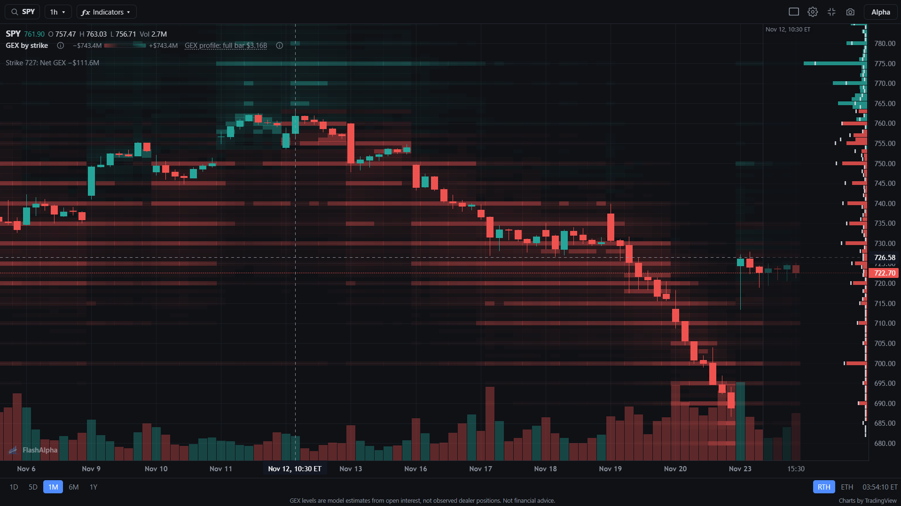

# GEX by strike indicator: strike heatmap and GEX profile on the price chart

**GEX by strike** shows dealer gamma exposure for every strike near the price, on the chart's price axis. It has two
layers: a **strike heatmap** behind the candles and a **GEX profile** at the right edge. Both can switch from gamma to
delta, vanna or charm exposure.

[← All indicators](../../README.md#indicators-at-a-glance) · Lowest plan: **Growth** ·
[Live demo](https://flashalpha-lab.github.io/tradingview-gex-flashalpha/)



---

## Strike heatmap

Net GEX per strike, drawn behind the candles for every bar.

- **Green** strikes are long gamma (dealers dampen moves there), **red** strikes short gamma (dealers may amplify moves).
- **Stronger colour, more gamma.** Opacity grows with the size of the exposure.
- **The 8 largest strikes stand out** in each snapshot; the others are faint. The Style option "Largest strikes only"
  draws those 8 alone.
- **Strikes far from the price fade**, so the area where the price trades stays readable.
- The legend shows the colour scale in dollars, for example `−$743.4M … +$743.4M`.
- Hover a strike to read its value, for example `Strike 727: Net GEX −$111.6M`.

## GEX profile

Net GEX per strike as horizontal bars at the right edge of the chart.

- It shows the **latest snapshot**, or the snapshot of the **bar under your cursor**, so you can scroll back through the
  session.
- **Light ticks mark where each strike's bar stood 15 minutes earlier**: you see which strikes are gaining or losing gamma.
- The legend gives the value of a full bar, for example `GEX profile: full bar $3.16B`.

## Lenses: GEX, DEX, VEX, CHEX

The **Value per strike** setting switches the heatmap and the profile between four exposures:

| Lens | Exposure | What it shows |
|---|---|---|
| **Net GEX** | Gamma | How dealer hedging reacts to price moves at each strike |
| **Net DEX** | Delta | The directional hedge dealers hold per strike |
| **Net VEX** | Vanna | How hedging per strike changes when implied volatility moves |
| **Net CHEX** | Charm | How hedging per strike drifts with time toward expiry |

## Benefits

1. **Find the strikes that matter.** The largest long-gamma strikes act as magnets and brakes; large short-gamma strikes
   can let the price run.
2. **See positioning build or fade over time.** The heatmap keeps the history, so you see a strike grow through the
   session, not only where it stands now.
3. **Read the latest shift.** The profile's 15-minute ticks show where new positioning is going right now.
4. **Go beyond gamma.** The vanna lens helps around volatility events; the charm lens into the close and expiry.
5. **Check the walls.** The heatmap shows why a wall is where it is, and whether a second strike nearby is close behind.

## Settings

| Setting | Options | Plan |
|---|---|---|
| Layers | Strike heatmap, GEX profile (right) | Growth |
| Value per strike | Net GEX, Net DEX, Net VEX, Net CHEX | Growth |
| Style | Colours above and below zero, "Largest strikes only" | Growth |
| Expiries | All, or 0DTE | Growth |
| Open interest | Settled, or Live (with today's flow; Live has the Net GEX lens only) | Alpha for Live |

The heatmap is drawn on intraday charts (1-minute to 1-hour), where per-strike snapshots exist.

## Add it to your chart

```html
<div data-flashalpha-chart data-symbol="SPX" data-layers="levels,heatmap,profile" style="height: 560px"></div>
<script async src="https://charts.flashalpha.com/embed.js" data-key="YOUR_FLASHALPHA_API_KEY"></script>
```

## FAQ

**What is the difference between the heatmap and the profile?**
The heatmap shows every strike over time, behind the candles. The profile shows one moment, larger and easier to compare,
at the right edge.

**Why is the heatmap empty on daily bars?**
Strike snapshots are intraday data. Switch to a 1-minute to 1-hour interval.

---

Related: [GEX Levels](gex-levels.md) · [Net GEX](net-gex.md) · [0DTE scope and live OI](0dte-and-live-oi.md) ·
[Get a free FlashAlpha API key](https://flashalpha.com/pricing?utm_source=github&utm_medium=docs&utm_campaign=tradingview-gex-flashalpha)
