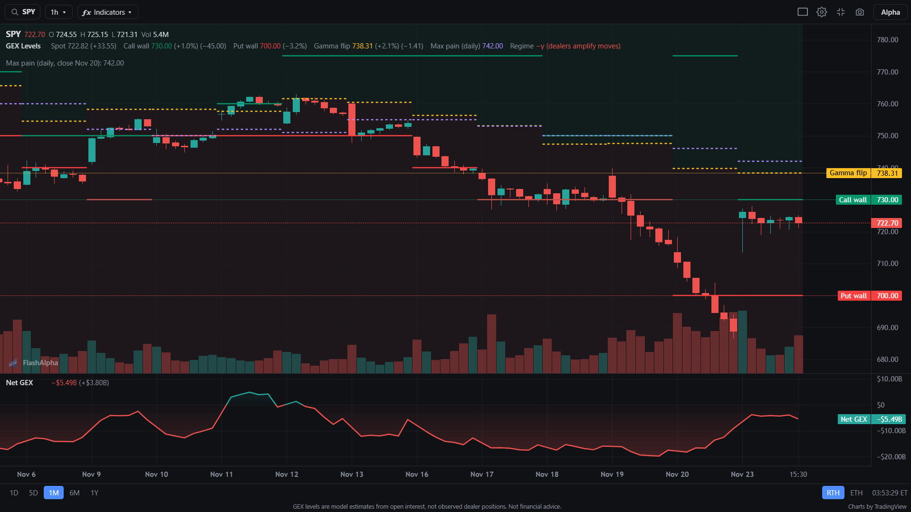

# GEX Levels indicator: call wall, put wall, gamma flip, max pain and 0DTE magnet

**GEX Levels** is the core FlashAlpha indicator. It draws the key options gamma exposure levels on a TradingView-style
candlestick chart, bar by bar: the call wall, the put wall, the gamma flip, max pain and the 0DTE magnet, with the gamma
regime tinted behind the candles.

[← All indicators](../../README.md#indicators-at-a-glance) · Lowest plan: **Basic** ·
[Live demo](https://flashalpha-lab.github.io/tradingview-gex-flashalpha/)



---

## What each level means

| Level | Style | Definition | Common reading |
|---|---|---|---|
| **Call wall** | Green, solid | The strike at or above spot with the largest call positioning | Resistance: dealer hedging tends to slow rallies into it |
| **Put wall** | Red, solid | The strike at or below spot with the largest put positioning | Support: dealer hedging tends to slow sell-offs into it |
| **Gamma flip** | Amber, dashed | The price where net dealer gamma changes sign (also called zero gamma) | Above: positive gamma, calmer market. Below: negative gamma, faster moves |
| **Max pain** | Violet, dashed | The strike at which open options would expire with the least total value | A pull toward the strike into expiration |
| **0DTE magnet** | Pink, dashed | The same-day strike with the strongest pull on the price | An intraday target on heavy 0DTE days |

A gamma flip that the data source has not yet certified is drawn lighter, so you know to treat it with care.

## What you see on the chart

- **Levels per bar.** Each level is a flat line segment per value, drawn on the same time axis as the candles. When a wall
  moves, you see the exact bar where it moved.
- **Gamma regime tint.** The background is green above the gamma flip and red below it, session by session.
- **Legend with distances.** The legend lists spot, the walls, the flip, max pain and the regime for the bar under your
  cursor, with each wall's and the flip's distance from spot and change since the previous session, for example
  `Call wall 730.00 (+1.0%) (−45.00)` and `Regime −γ (dealers amplify moves)`.
- **Edge labels.** A level outside the visible price range is pinned to the top or bottom of the chart with its distance
  from the last close, for example `▲ Call wall 8,000.00 (+11.5%)`. The price scale fits the candles, not the levels.
- **Broken walls (optional).** Turn on "Call wall broken" or "Put wall broken" in the Style tab. When a candle closes
  through a wall, the wall fades for the rest of the session, a marker such as `Put wall broken 10:30` sits on the bar,
  and the legend reads `Put wall 730.00 (broken)`.
- **Previous-session levels.** On daily and weekly bars each session shows the previous close's levels as dashed lines.
- **Session focus.** On intraday charts, the session under the cursor stands out and the other sessions fade.
- **Price lines only for today.** The horizontal price lines and axis labels show while the latest session is in view,
  so scrolling back never marks another day's level as current.

## Benefits

1. **Support and resistance from positioning, not from drawing.** The walls come from options data, updated through the
   session, instead of lines you draw by hand.
2. **Regime awareness before every trade.** The tint tells you if you are in a range-bound (positive gamma) or a trending
   (negative gamma) market.
3. **Context for breakouts.** A close through the call wall in a negative gamma regime is a different trade from a test of
   the wall in a positive gamma regime.
4. **Expiration-day planning.** Max pain and the 0DTE magnet show where the price may be pulled into the close.

## Settings

| Setting | Options | Plan |
|---|---|---|
| Layers | Walls & gamma flip, Max pain, 0DTE magnet | Basic |
| Style per level | Colour, width, line style, price line, axis label, values in the legend | Basic |
| Broken walls | Call wall broken, Put wall broken (switch and marker colour) | Basic |
| Expiries | All, or 0DTE (today's expiry only) | Growth for 0DTE |
| Open interest | Settled, or Live (with today's flow) | Alpha for Live |

## Add it to your chart

```html
<div data-flashalpha-chart data-symbol="SPX" data-layers="levels,maxpain,magnet" style="height: 520px"></div>
<script async src="https://charts.flashalpha.com/embed.js" data-key="YOUR_FLASHALPHA_API_KEY"></script>
```

## FAQ

**Is the call wall always resistance?**
No. It is where dealer hedging is expected to slow a rally. In a negative gamma regime, or after a close above it, the
price can run through it.

**Why does the gamma flip move during the day?**
It is recalculated as the price, open interest and time to expiry change. The chart draws each value at the bar where it
applied.

**Are these levels financial advice?**
No. They are model estimates from open interest, not observed dealer positions.

---

Related: [Net GEX](net-gex.md) · [Strike heatmap and GEX profile](gex-by-strike.md) · [0DTE scope and live OI](0dte-and-live-oi.md) ·
[Get a free FlashAlpha API key](https://flashalpha.com/pricing?utm_source=github&utm_medium=docs&utm_campaign=tradingview-gex-flashalpha)
