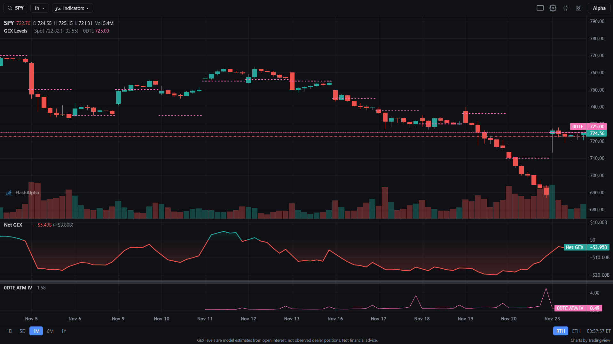

# Greeks exposure and 0DTE metrics pane: delta, vanna, charm, pin score and more

The **metrics pane** adds one options exposure or 0DTE metric under the candlestick chart, minute by minute: delta (DEX),
vanna (VEX) or charm (CHEX) exposure, or a FlashAlpha metric such as the 0DTE pin score, the 0DTE move left, the IV ratio,
VIX or the dealer hedge on a 1 % move. Pick it in the **Metric pane** setting of the Net GEX indicator (Indicators menu,
options ⚙).

[← All indicators](../../README.md#indicators-at-a-glance) · Lowest plan: **Basic** (Greeks), **Growth** (metrics) ·
[Live demo](https://flashalpha-lab.github.io/tradingview-gex-flashalpha/)

---

## Greeks exposure (Basic)

| Metric | What it measures | Why it matters |
|---|---|---|
| **Delta (net DEX)** | The directional hedge dealers hold | Large DEX means large hedge adjustments when positions close or roll |
| **Vanna (net VEX)** | How dealers' delta changes when implied volatility moves | A volatility drop after an event can force dealers to buy or sell the underlying |
| **Charm (net CHEX)** | How dealers' delta changes as time passes | Drives hedging flows into the close and into expiration |

## 0DTE and volatility metrics (Growth)

| Metric | What it tells you |
|---|---|
| **0DTE pin score** | How likely the price is to pin near a strike today |
| **0DTE move left (±$)** | The 1σ move options still price for the rest of the day |
| **0DTE ATM IV** | Implied volatility of today's at-the-money options |
| **IV ratio 0DTE / 7DTE** | Whether same-day options are rich or cheap against the week |
| **25Δ skew** | Demand for downside protection against upside calls |
| **VIX** | The market's 30-day implied volatility |
| **0DTE net GEX** | Gamma exposure from today's expiry alone |
| **0DTE share of GEX (%)** | How much of total gamma sits in same-day options |
| **0DTE put/call volume** | Same-day put volume against call volume |
| **0DTE net theta ($)** | The time decay same-day options lose |
| **Distance to flip (σ)** | How far the price is from the gamma flip, in standard deviations |
| **Dealer hedge if +1 % / −1 % ($)** | The notional dealers would trade if the price moved 1 % |

With a Growth plan you can also pick any other column the FlashAlpha chart API offers for this pane.

## Benefits

1. **The why behind the levels.** GEX Levels show where; the metrics pane shows the forces that move them.
2. **Plan around the close.** Charm and the pin score help you see if the price is likely to pin or break away late in
   the day.
3. **Size the risk of a move.** The dealer hedge on ±1 % tells you how much buying or selling a 1 % move could trigger.
4. **Volatility context in one pane.** IV, the 0DTE / 7DTE ratio, skew and VIX sit on the same time axis as the price.

## Settings

| Setting | Options |
|---|---|
| Metric pane | One metric at a time, in the options of the Net GEX indicator |
| Expiries | All, or 0DTE (Growth) |

The metrics pane is drawn on intraday charts (1-minute to 1-hour).

## FAQ

**What is vanna exposure?**
The change in dealers' delta when implied volatility changes. After an event, falling volatility can push dealers to buy
back hedges, a flow often called a vanna rally.

**What is charm exposure?**
The change in dealers' delta as time passes. It grows into the close and into expiration.

**What is the 0DTE pin score?**
A FlashAlpha score of how strongly same-day options positioning pulls the price toward a strike today. Higher means a
stronger pin.

---

Related: [GEX Levels](gex-levels.md) · [Net GEX](net-gex.md) · [0DTE scope and live OI](0dte-and-live-oi.md) ·
[Get a free FlashAlpha API key](https://flashalpha.com/pricing?utm_source=github&utm_medium=docs&utm_campaign=tradingview-gex-flashalpha)
