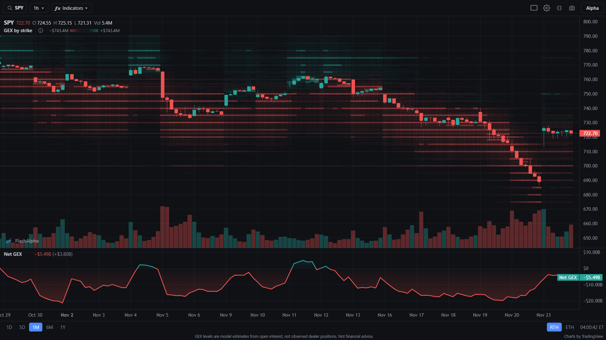

# Net GEX indicator: net dealer gamma exposure under the price chart

**Net GEX** draws the total dealer gamma exposure, in dollars, as a line around zero in its own pane under the
candlestick chart. Above zero it is green (dealers long gamma), below zero red (dealers short gamma).

[← All indicators](../../README.md#indicators-at-a-glance) · Lowest plan: **Basic** ·
[Live demo](https://flashalpha-lab.github.io/tradingview-gex-flashalpha/)



---

## What net GEX means

Net GEX adds up the gamma exposure of every strike: call gamma minus put gamma, weighted by open interest and the
underlying price. It estimates how many dollars of the underlying dealers must trade for each move in the price.

| Net GEX | Dealer behaviour | Typical market |
|---|---|---|
| **Positive** (green) | Dealers sell strength and buy weakness | Calmer, mean-reverting, prices pin near large strikes |
| **Near zero** | Little hedging pressure either way | Transition zone, often around the gamma flip |
| **Negative** (red) | Dealers buy strength and sell weakness | Faster, trending moves and wider ranges |

## What you see on the chart

- A line around zero, filled green above and red below, cut between sessions.
- The legend line at the top left of the pane: net GEX and its change since the previous session, for example
  `Net GEX −$5.49B (+$3.80B)`.
- Hovering a session fades the other sessions, as on the price pane.

## Benefits

1. **See the regime change as it happens.** A cross from green to red tells you hedging has turned from a brake into an
   accelerator.
2. **Measure the strength, not only the sign.** +$5B of net GEX holds the market much tighter than +$200M.
3. **Compare sessions.** The change against the previous session shows whether positioning is building or unwinding.
4. **Pair it with GEX Levels.** A test of the put wall with net GEX falling deeper into the red is a weaker support than the
   same test with net GEX rising.

## Settings

| Setting | Options |
|---|---|
| Style | Line colour above zero, colour below zero, width, line style, price line, axis label |
| Metric pane | Adds a [Greeks or 0DTE metric pane](metrics-pane.md) under the price |
| Expiries | All, or 0DTE (Growth) |
| Open interest | Settled, or Live (Alpha) |

## Add it to your chart

```html
<div data-flashalpha-chart data-symbol="SPY" data-layers="levels,netgex" style="height: 560px"></div>
<script async src="https://charts.flashalpha.com/embed.js" data-key="YOUR_FLASHALPHA_API_KEY"></script>
```

## FAQ

**Is negative net GEX bearish?**
Not by itself. It means moves in either direction may be larger. It is about volatility, not direction.

**Why is net GEX in dollars?**
Dollars make symbols comparable and show how much hedging the market may have to absorb.

---

Related: [GEX Levels](gex-levels.md) · [Strike heatmap and GEX profile](gex-by-strike.md) · [Greeks and 0DTE metrics](metrics-pane.md) ·
[Get a free FlashAlpha API key](https://flashalpha.com/pricing?utm_source=github&utm_medium=docs&utm_campaign=tradingview-gex-flashalpha)
